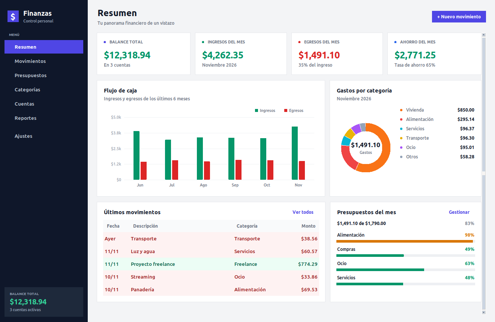

# Finanzas — control de finanzas personales

Aplicación de escritorio para registrar ingresos, egresos y transferencias, ver tu
balance real por cuenta y por mes, controlar presupuestos y generar reportes.
Está hecha con **Python + Tkinter + SQLite** y no necesita conexión a internet ni
dependencias externas.



## Características

- **Resumen (dashboard)**: balance total, ingresos, egresos, ahorro del mes,
  gráfica de flujo de los últimos 6 meses, gastos por categoría y últimas
  transacciones.
- **Movimientos**: alta, edición y borrado de ingresos, egresos y transferencias
  entre cuentas. Incluye búsqueda, filtros por tipo, categoría, cuenta y rango de
  fechas, orden por columna, paginación y deshacer (`Ctrl+Z`).
- **Búsqueda avanzada**: combina operadores con texto libre, por ejemplo
  `categoria:Ocio monto>100`, `cuenta:Efectivo`, `tipo:ingreso`,
  `fecha:2026-05` o `texto:"luz y agua"`. Los valores con espacios se escriben
  entre comillas.
- **Movimientos recurrentes**: renta, salario, suscripciones y servicios con
  frecuencia mensual, quincenal, semanal o anual. Al abrir la app se crean los
  movimientos pendientes (sin duplicar ocurrencias) y también puede forzarse el
  proceso desde la vista **Recurrentes**.
- **Reglas automáticas**: si la descripción o las notas contienen un texto, se
  asigna una categoría y/o una cuenta al crear un movimiento. Se pueden aplicar
  a movimientos existentes y desactivar por movimiento.
- **Multi-moneda**: cada cuenta puede tener su propia moneda. Los tipos de cambio
  se guardan por fecha y los saldos, reportes y totales se consolidan en una
  moneda base configurable.
- **Ver en otra moneda**: el selector **Ver en** de la cabecera (y de Ajustes)
  convierte todos los montos de la interfaz a una moneda extranjera con tasa
  registrada, sin crear cuentas nuevas ni modificar los datos guardados. Al
  volver a la moneda base se muestran los valores originales.
- **Presupuestos**: límite mensual por categoría de gasto con barra de avance,
  porcentaje usado y alertas visuales al acercarte o pasarte del límite. Avisa si
  sales de la vista con cambios sin guardar.
- **Categorías**: categorías propias para ingresos y gastos, con color.
  Si una categoría ya tiene movimientos, se archiva en lugar de borrarse para no
  perder el historial.
- **Cuentas**: efectivo, banco, tarjeta, ahorro e inversión, con moneda y saldo
  consolidado. El saldo se calcula con el saldo inicial más todos los
  movimientos, incluidas las transferencias (con su monto de destino).
- **Reportes**: resumen mensual del año, tasa de ahorro, distribución de gastos
  por categoría y exportación a CSV.
- **Apariencia**: modo claro y oscuro conmutable desde Ajustes, persistente entre
  sesiones. La interfaz se reconstruye al instante sin reiniciar.
- **Ajustes**: tema, símbolo y formato de moneda (`1,234.56` o `1.234,56`),
  moneda base, moneda de visualización, tipos de cambio por fecha,
  respaldo/restauración en JSON, exportación completa a CSV, datos de ejemplo y
  borrado total.
- **Memoria de trabajo**: al abrir, la app vuelve a la última sección visitada y
  restaura los filtros de Movimientos.
- **Datos locales**: todo vive en una base SQLite en tu equipo. No hay cuentas ni
  servidores.

## Requisitos

- Python **3.10 o superior**.
- Tkinter (suele venir con Python; en Linux puede requerir el paquete del sistema).

```bash
# Debian / Ubuntu
sudo apt install python3-tk
# Fedora
sudo dnf install python3-tkinter
# Arch
sudo pacman -S tk
```

En Windows y macOS, Tkinter viene incluido con el instalador oficial de Python.

## Cómo ejecutarla

```bash
cd finanzas
python3 main.py
```

También puedes usar el módulo:

```bash
python3 -m finanzas
```

Al abrir por primera vez verás la pantalla de bienvenida. Puedes registrar tu
primer movimiento o cargar **datos de ejemplo** (seis meses de movimientos y
presupuestos) para explorar la aplicación; luego puedes borrarlos desde Ajustes.

## Versión móvil (Android e iPhone)

La carpeta [`mobile/`](mobile/README.md) contiene una app nativa hecha con
**Flutter**, también 100 % offline. Usa el mismo esquema SQLite, montos en
centavos, fechas ISO y el mismo formato de respaldo JSON que la versión de
escritorio, así que puedes mover tus datos con *Exportar respaldo* /
*Restaurar respaldo*.

Incluye resumen, movimientos, cuentas, presupuestos, reportes, categorías,
recurrentes, reglas, ajustes y el selector **Ver en**. Consulta
[`mobile/README.md`](mobile/README.md) para instalar Flutter, compilar el APK de
Android y los pasos para iPhone desde macOS.

Si no quieres instalar Android Studio, el repositorio incluye
`.github/workflows/android.yml` (GitHub Actions) y `codemagic.yaml`
(Codemagic) para compilar el APK en la nube y descargarlo desde el navegador.
Las instrucciones están en
[`mobile/README.md`](mobile/README.md#compilar-sin-android-studio-en-la-nube).

## Ver los montos en otra moneda

Puedes convertir toda la interfaz a una moneda extranjera sin crear cuentas
nuevas ni cambiar los datos guardados:

1. En **Ajustes → Tipos de cambio**, registra una tasa. Por ejemplo, si tu
   moneda base es MXN, una tasa `USD = 18` significa **1 USD = 18 MXN**.
2. En la cabecera, usa el selector **Ver en** y elige `USD`. También está
   disponible en **Ajustes → Moneda y formato → Mostrar montos en**.
3. Todos los saldos, totales, movimientos, presupuestos y reportes se muestran
   convertidos. La cabecera indica la tasa aplicada y que es solo visualización.
4. Elige la moneda base en el mismo selector para volver a los valores
   originales.

La conversión de movimientos históricos usa la tasa vigente en la fecha de cada
movimiento; los saldos consolidados usan la tasa más reciente. Si eliminas la
tasa de la moneda elegida, la app vuelve automáticamente a la moneda base. Los
presupuestos se capturan en la moneda elegida y se guardan convertidos a la base.

## Dónde se guardan los datos

Por defecto:

- Linux: `~/.local/share/finanzas/finanzas.db`
- macOS/Windows: `~/.local/share/finanzas/finanzas.db` (se crea igualmente)

Puedes elegir otra ubicación con la variable de entorno `FINANZAS_DB`:

```bash
FINANZAS_DB=/ruta/a/mis_finanzas.db python3 main.py
```

Los respaldos son archivos JSON que incluyen cuentas, categorías, movimientos,
presupuestos, reglas automáticas, movimientos recurrentes, tipos de cambio y
ajustes. Restaurarlos reemplaza todos los datos actuales.

## Atajos de teclado

| Atajo | Acción |
| --- | --- |
| `Ctrl+N` | Nuevo movimiento |
| `Ctrl+F` | Ir a Movimientos y enfocar la búsqueda |
| `Ctrl+Z` | Deshacer la última acción (fuera de un campo de texto) |
| `F5` | Actualizar la vista actual |
| `Supr` | Eliminar el movimiento seleccionado |
| `Esc` | Cerrar un diálogo |
| `Ctrl+Q` | Salir |

## Estructura del proyecto

```
finanzas/
├── main.py                 # lanzador
├── pyproject.toml
├── finanzas/
│   ├── app.py              # ventana principal, navegación y avisos
│   ├── db.py               # acceso a SQLite, consultas y respaldos
│   ├── utils.py            # fechas, montos en centavos y formato
│   ├── theme.py            # paleta, tipografías y estilos ttk
│   ├── widgets.py          # tarjetas, gráficas y widgets reutilizables
│   ├── dialogs.py          # diálogos de movimiento, cuenta, recurrente y regla
│   └── views/              # una vista por sección
│       ├── dashboard.py
│       ├── transactions.py
│       ├── recurring.py
│       ├── budgets.py
│       ├── categories.py
│       ├── accounts.py
│       ├── rules.py
│       ├── reports.py
│       └── settings.py
├── tests/
│   └── test_core.py        # pruebas de lógica, base de datos y migraciones
└── mobile/                 # app nativa Flutter para Android e iPhone
```

Los montos se guardan como **enteros en centavos** para evitar errores de
redondeo de los números flotantes. Las fechas se guardan en formato ISO
(`AAAA-MM-DD`) y se muestran como `dd/mm/aaaa`.

## Pruebas

```bash
python3 -m unittest discover -s tests -v
```

## Puntos a mejorar

El plan de evolución (rendimiento, funciones nuevas, UX, calidad y seguridad)
está en [MEJORAS.md](MEJORAS.md).
